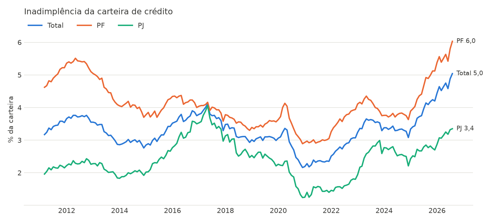
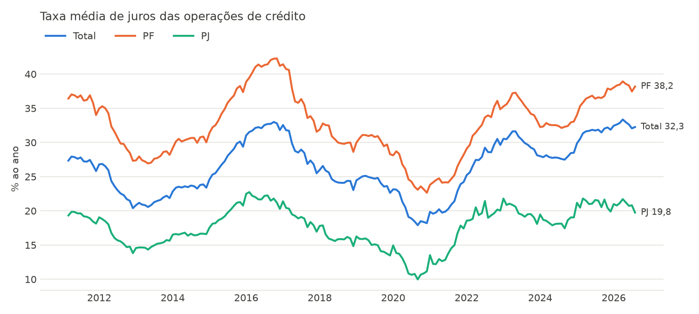

# Análise do crédito no Brasil

[](https://github.com/LuisLopoFranco/analise-credito-brasil/actions/workflows/ci.yml)

Como evoluíram os juros e a inadimplência do crédito no Brasil desde 2011, e
quanto tempo uma Selic alta leva para aparecer na inadimplência. Dados abertos
do Banco Central, tratados com Python e analisados em SQL.



## Perguntas e conclusões

Dados de março de 2011 a 2026 (2026 ainda incompleto).

1. **A inadimplência de pessoa física é quantas vezes a de pessoa jurídica?**
   Entre 1,1 e 2,3 vezes, e essa razão muda bastante com o ciclo. Ela caiu de
   2,33 (2012) para 1,12 (2017) porque, com a recessão, a inadimplência das
   empresas subiu de 1,97% (2014) para 3,55% (2017). Voltou a 2,09 em 2021 e
   2,27 em 2022, quando a de PJ ficou nos menores níveis da série (1,43% em
   2021), e está em 1,77 em 2026. Na média de cada ano, pessoa física sempre
   atrasa mais que empresa.

2. **A diferença de juros entre PF e PJ aumentou ou diminuiu?**
   Não seguiu uma tendência única: tende a acompanhar a Selic. Foi de 19,2 pontos
   percentuais em 2016 (Selic média de 14,2%) a 10,8 pontos em 2021 (Selic de
   4,5%), e voltou a 17,4 pontos em 2026, com a Selic de novo acima de 14%.
   Em todos os anos, PF pagou de 1,7 a 2,1 vezes os juros de PJ.

   

3. **A Selic alta antecipa a inadimplência? Com quantos meses de atraso?**
   Sim, com cerca de **9 meses** de atraso. A correlação entre a Selic de um
   mês e a inadimplência total do mesmo mês é 0,57; ela sobe a cada mês de
   defasagem até **0,825 com 9 meses** (177 meses comparados) e depois cai.
   Hoje a Selic média (14,5%) e a inadimplência total (4,7%) de 2026 são as
   maiores médias anuais da série. Correlação não prova causa: Selic e
   inadimplência respondem também ao mesmo ciclo econômico (inflação, emprego,
   renda), e a queda da inadimplência em 2020 provavelmente reflete as
   renegociações e pausas de pagamento da pandemia, não uma melhora real.

## Dados

| Código SGS | Série | Frequência |
| --- | --- | --- |
| 432 | Selic meta (% a.a.) | diária |
| [20714](https://dadosabertos.bcb.gov.br/dataset/20714-taxa-media-de-juros-das-operacoes-de-credito---total) | Juros médios do crédito, total (% a.a.) | mensal |
| [20715](https://dadosabertos.bcb.gov.br/dataset/20715-taxa-media-de-juros-das-operacoes-de-credito---pessoas-juridicas---total) | Juros médios do crédito, PJ (% a.a.) | mensal |
| [20716](https://dadosabertos.bcb.gov.br/dataset/20716-taxa-media-de-juros-das-operacoes-de-credito---pessoas-fisicas---total) | Juros médios do crédito, PF (% a.a.) | mensal |
| [21082](https://dadosabertos.bcb.gov.br/dataset/21082-inadimplencia-da-carteira-de-credito---total) | Inadimplência, total (%) | mensal |
| [21083](https://dadosabertos.bcb.gov.br/dataset/21083-inadimplencia-da-carteira-de-credito---pessoas-juridicas---total) | Inadimplência, PJ (%) | mensal |
| [21084](https://dadosabertos.bcb.gov.br/dataset/21084-inadimplencia-da-carteira-de-credito---pessoas-fisicas---total) | Inadimplência, PF (%) | mensal |

## Como funciona

```
API do Banco Central (SGS)  ->  src/coleta.py  ->  dados/bruto/*.csv
                                src/carga.py   ->  dados/credito.duckdb (tabela series)
                                sql/*.sql + src/analise.py  ->  resultados e docs/graficos/
```

- **Coleta:** a API do SGS recusa consultas longas de séries diárias, então o
  período é dividido em janelas de 5 anos.
- **Carga:** DuckDB lê todos os CSVs de uma vez e grava uma tabela única no
  formato longo (`codigo, nome, data, valor`).
- **Análise em SQL:** `PIVOT` para comparar PF e PJ, `corr()` com defasagem de
  0 a 18 meses para relacionar Selic e inadimplência.
- **Testes:** as consultas são testadas com dados sintéticos de resultado
  conhecido (por exemplo, uma inadimplência que repete a Selic de 12 meses
  antes precisa dar correlação 1,0 com defasagem 12). O CI roda os testes a
  cada push.

## Como rodar

```bash
python -m venv .venv

# Linux/macOS:
source .venv/bin/activate
# Windows (cmd):
.venv\Scripts\activate.bat
# Windows (PowerShell):
.venv\Scripts\Activate.ps1
#   se aparecer "a execução de scripts foi desabilitada", rode antes:
#   Set-ExecutionPolicy -Scope CurrentUser RemoteSigned

pip install -r requirements-dev.txt

python -m src.coleta    # baixa as séries do Banco Central
python -m src.carga     # carrega no DuckDB
python -m src.analise   # mostra os resultados e gera os gráficos
pytest                  # roda os testes
```

## Próximos passos

- Dashboard no Power BI conectado aos CSVs, com print aqui no README.
- Incluir estatísticas do Pix (API Olinda do Banco Central).

## Autor

Luis Gabriel Lopo · [LinkedIn](https://linkedin.com/in/luis-gabriel-lopo)
